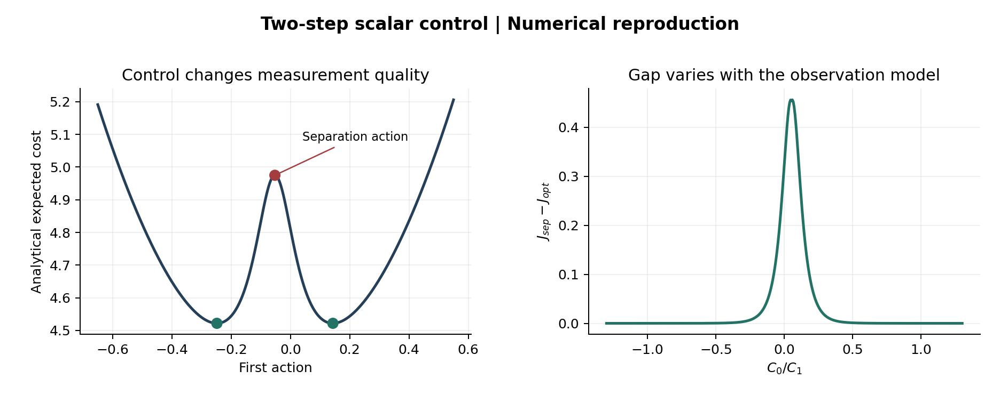

# Algorithms: A Computational Standpoint

**Selected computational studies in stochastic control and generative modeling.**

This collection examines how mathematical models behave when implemented: when
control inputs affect information, how numerical optimization is checked, and
how a generative-model experiment can fail despite an apparently favorable score.
It is a research portfolio, not a general-purpose software library.

> Release candidate, 18 November 2026. Individual contribution and reuse terms
> must be completed in [CONTRIBUTIONS.md](CONTRIBUTIONS.md) before public release.

## Start with the verified example

[Separation-principle gap](studies/separation_gap/README.md) is a small two-step
control experiment based on published work. An analytical solution, polynomial
stationary-point search, and Monte Carlo simulation agree for the supplied setting.
The computed expected-cost gap is **0.453214**. This is a numerical reproduction
of a known phenomenon, not a new optimal-control theorem.



| Study | Evidence included | Current status |
|---|---|---|
| [Separation-principle gap](studies/separation_gap/README.md) | Executable script, original notebook, CSV, figure and validation checks | Rerun in the audit environment |
| [Belief-space MPC](studies/belief_mpc/README.md) | Planning/filter/controller implementation, original notebook and explicit run modes | Source reviewed; PyTorch execution pending |
| [DMD pilot](studies/dmd_pilot/README.md) | Source and supplied per-seed tables; evaluator and collapse diagnostics | Exploratory negative result; full training not rerun |

## Run the small example

Python 3.11 or later is recommended. From this repository directory:

```bash
python3 -m venv .venv
source .venv/bin/activate
python -m pip install -r requirements.txt
python studies/separation_gap/run.py
python -m unittest discover -s tests -v
```

On Windows, activate with `.venv\Scripts\activate` instead. The two-step example
uses synthetic data and needs no GPU or external dataset. Check
[environment-tested.json](environment-tested.json) for exact versions used here.
Dependency ranges are compatibility targets, not a guarantee of every combination.

## Interpretation and attribution

- Separate mathematical derivations, replications and exploratory modifications.
- Report optimizer tolerances, uncertainty and failed checks alongside figures.
- Interpret each result within its stated model and measurement limitations.
- See [REFERENCES.md](REFERENCES.md), [PROVENANCE.md](PROVENANCE.md),
  [CONTRIBUTIONS.md](CONTRIBUTIONS.md), and [VALIDATION.md](VALIDATION.md).

Third-party papers, unpublished manuscripts, native presentation decks and face
image galleries are not distributed in this candidate. They are not needed to run
the flagship example. No open-source license is asserted at this stage.
